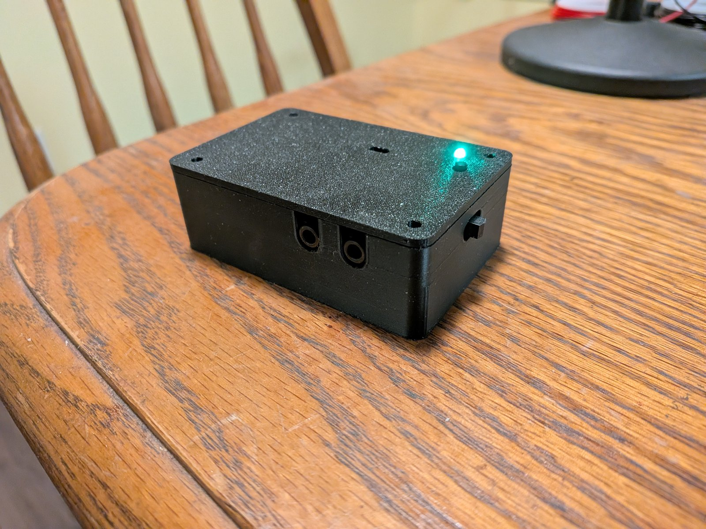
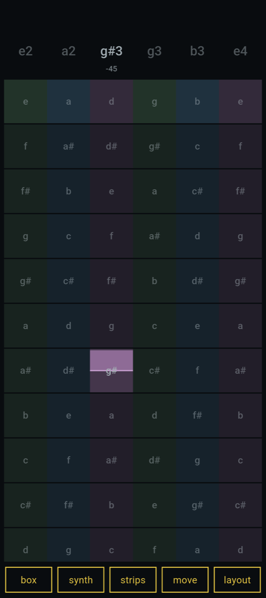
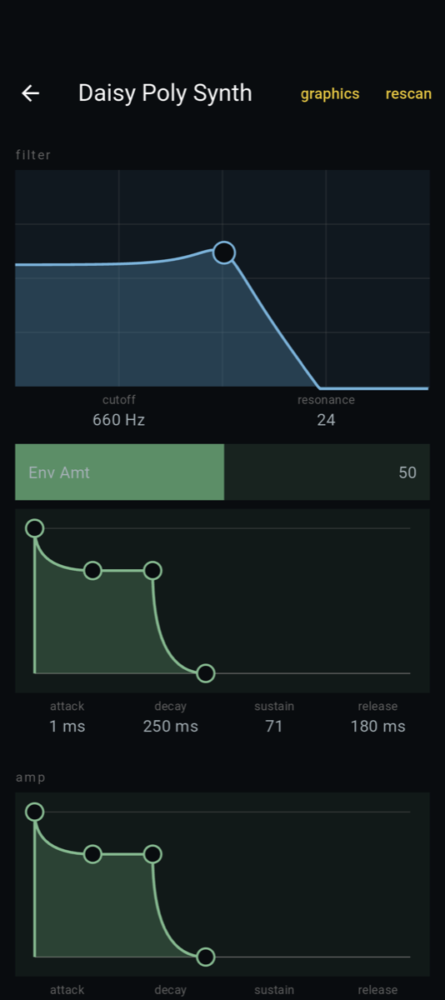
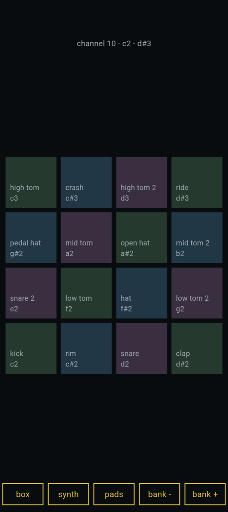
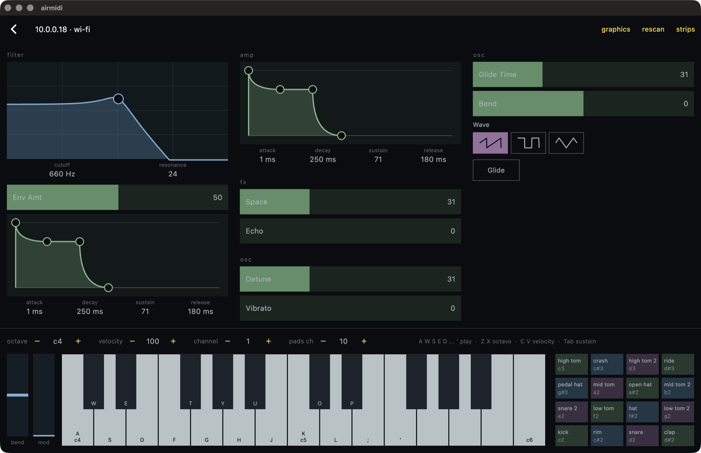
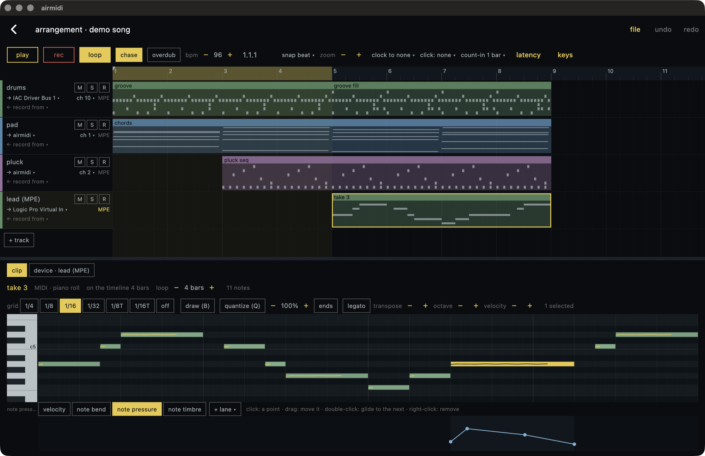
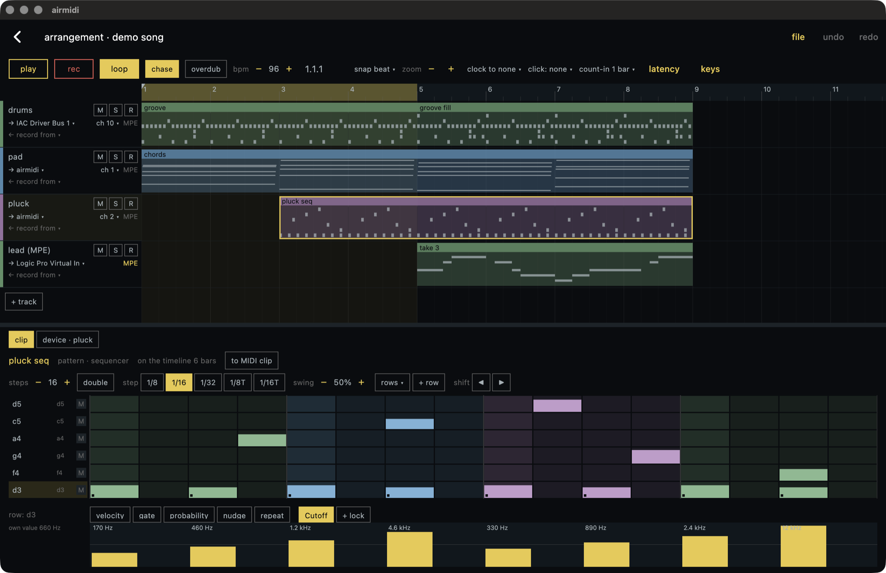

# AirMidi

[](https://github.com/TTeuber/AirMidi/actions/workflows/ci.yml)
[](LICENSE)

A battery-powered wireless MIDI interface: it gives any TRS MIDI device (or DIN, with an adapter) Bluetooth and Wi-Fi,
is set up from a browser or a phone, and updates itself over the air. This repo is its firmware, for an ESP32-C6 or
ESP32-S3 on a custom PCB in a 3D-printed box, and the apps that play it: one for Android phones and one for the Mac,
which sequences hardware synths through the box.



## Highlights

- **Six MIDI transports through one router**: TRS (31250 baud UART), BLE MIDI (peripheral and central), Network
  MIDI 2.0, RTP-MIDI, USB MIDI and an ESP-NOW link between two boxes. Everything is UMP (MIDI 2.0's packet format)
  inside, translated to and from MIDI 1.0 at the edges, with a per-output merge that never breaks a SysEx message.
- **Protocols built from their specs and tested against real implementations**: macOS's own Network MIDI 2.0 and
  RTP-MIDI drivers connect to the box; the RTP-MIDI recovery journal (RFC 6295) repairs lost packets; MIDI-CI
  Property Exchange reads a synth's controls over a 31250 baud cable and the web UI draws them.
- **A portable C11 core** (`lib/`, no ESP-IDF headers) with 17 suites of host tests under AddressSanitizer and
  UndefinedBehaviorSanitizer, including property tests (the journal through 30-50% packet loss).
- **Measured on the hardware, not assumed**: an audio interface cabled to the box's jacks puts both ends of every
  test on the Mac's clock, so latency and loss are measured one way, per transport. Every number below comes from
  those tests.
- **Safe updates**: signed images (RSA-3072), a self-test after each update and automatic rollback, core dumps
  from crashes; releases are built and signed in GitHub Actions.
- **Apps for phone and desktop** from one Flutter project: an Android app that sets the box up over Bluetooth and
  plays it as an MPE instrument, and a macOS app with a MIDI-only DAW for hardware synths, whose tracks know each
  synth's controls from what it sent over MIDI-CI.

## Hardware


The receiver PCB: a Seeed XIAO ESP32-C6 (or ESP32-S3) on headers, MIDI out through a TRS Type A jack, MIDI in
through a 6N138 optocoupler, a Li-ion cell with a TP4057 USB-C charger and a TPS63020 buck-boost to 3.3 V, a power
switch, a button and an LED. An ESP32-S3-DevKitC-1 serves as the second box for USB MIDI and the ESP-NOW link. The
board layer ([board-and-settings.md](docs/design/board-and-settings.md)) is the only code that names a GPIO.

**[hardware/](hardware)** has the schematic, the KiCad project, Gerbers, BOM and the printable enclosure, with the
board's revision history: the photo shows rev A, and rev B fixes what its bring-up found.

## Features

- **TRS <-> BLE MIDI**, up to two BLE centrals at once. One way through the box: BLE -> TRS 8.4 ms median,
  TRS -> BLE 9.5 ms, nothing lost in the hardware tests.
- **Wi-Fi modes**: Play (Wi-Fi off), Network (joins stored networks, reachable as `<name>.local`), Setup (its own
  access point). A long press switches mode, an 8 s press opens Setup, a double press sends all notes off.
- **Web UI** at `http://<name>.local`: live traffic per port, battery, signal, settings, Wi-Fi networks, firmware
  updates. Plain JS, no framework, 18 KB, built into the firmware.
- **Network MIDI 2.0** host (UDP, `_midi2._udp`): macOS connects to it natively. FEC, retransmit and in-order
  delivery over Wi-Fi: 0 of 600 lost at 5 ms spacing, 6.7 ms median Mac -> TRS, 4.2 ms back.
- **MIDI-CI over TRS**: Discovery and Property Exchange with the synth on the jacks (a full read in under a second
  at 31250 baud, ~50 ms for a known device from the flash cache). The play page draws the synth's own faders,
  pickers and toggles from its control list (M2-117); synths without MIDI-CI get the same from an uploaded JSON
  profile. A MIDI-CI host behind the box reaches the synth through it: macOS finds it over Network MIDI 2.0.
- **RTP-MIDI** (AppleMIDI, `_apple-midi._udp`) for clients without Network MIDI 2.0: lost packets repaired from the
  recovery journal, sessions taken back after the box restarts. With macOS's driver: 0 of 600 lost each way at 5 ms
  spacing, 7.3 / 5.5 ms median.
- **BLE central**: the box connects by itself to a BLE MIDI keyboard or controller (any, by name or by address).
  13.0 ms median keyboard -> TRS.
- **USB MIDI** on the S3: a class-compliant USB MIDI device named after the box, with a serial console beside it.
- **ESP-NOW link**: two boxes pass MIDI radio to radio, no router, and find each other's Wi-Fi channel by
  themselves. TRS -> box -> ESP-NOW -> box -> USB in 3.8 ms median, nothing lost.
- **Updates**: upload in the browser, fetch the latest GitHub release, or send it over BLE when the box is not on
  Wi-Fi. Only signed images install; a new image must pass a self-test or the box rolls back.
- **Battery**: gauge, low warning, and all notes off plus deep sleep when the cell is empty.

## Web UI


## Apps

One Flutter project ([app/](app)) builds two apps over shared code: the box pages, the BLE and Wi-Fi links, and the
synth page drawn from the synth's MIDI-CI control list.

**Phone** (Android; [plan and decisions](docs/app.md)):

- Finds the box over Bluetooth or Wi-Fi and sets it up: mode, Wi-Fi networks from the box's own scan, trusted
  phones. Setup goes over a BLE GATT service that carries the same JSON API as the web UI's HTTP.
- Plays the synth on the box's TRS jacks: pedal-steel strips (each finger bends its own note, one MPE channel per
  strip), keys, or drum pads; over BLE MIDI, the box's WebSocket, or Android's MIDI service straight to a computer.
- The synth page: envelopes, a cutoff and resonance pad, wave pickers and faders, built from the controls daisy_synth
  ([devices/daisy_synth](devices/daisy_synth)) describes over MIDI-CI.

<p>
  
  
  
</p>

**Desktop** (macOS now, Windows and Linux later; [plan](docs/desktop.md), [DAW design](docs/daw.md)):

- The computer's MIDI ports through libremidi over FFI (`app/packages/midi_engine`), a router between them, and the
  box's play view: the synth's controls over the keys.
- A MIDI-only DAW for hardware: MIDI clips in a piano roll with controller lanes and ramps, MPE takes with each
  note's own bend, pressure and timbre, and step-sequencer patterns with velocity, gate, probability, nudge, repeats
  and parameter locks. Records from any input, MPE included.
- Each track keeps its synth's MIDI-CI control list, so lanes and locks have the synth's own names and units. It also
  keeps the synth's program, bank and settings, which can be read back through the box. All of it is sent before
  play, so the song sounds the same on the next day.
- Click and count-in, latency offsets per port, projects saved as JSON every few seconds, Standard MIDI File import
  and export.







## How it is tested

- **Host tests** (`test/`): the portable core under ASan + UBSan, with randomized round trips and property tests.
- **App tests** (`app/test`, `flutter test`): the strips, MPE and BLE MIDI packing, the router, and the DAW (editing,
  timing, files, recording, the player against a fake MIDI engine).
- **CI** (`.github/workflows/ci.yml`): host tests, the clang-format check, and the firmware for all three boards on
  every push. `tools/check.sh` runs the same steps locally. Tagging `vX.Y.Z` builds, signs and publishes a release.
- **Hardware in the loop** (`tools/hil/`): Python and Swift tools on the Mac drive the box and an Arturia AudioFuse
  wired to its jacks. Their first runs found real bugs; each one is written up in [docs/design](docs/design).

| Test | Checks |
|---|---|
| `bridge_test.py` | TRS <-> BLE both ways: notes, CCs on all 16 channels, clock, long SysEx, bursts, two sources merged (15) |
| `ota_test.py`, `release_test.py`, `ble_ota_test.py` | unsigned, corrupted and wrongly signed images refused; good ones installed over Wi-Fi, from a release and over BLE; rollback after a failed self-test or a crash (13, 8, 9) |
| `web_test.py`, `ws_test.py` | the web API, and MIDI between the page and the jacks over WebSocket (14) |
| `ci_test.py`, `mac_ci_test.py` | MIDI-CI against a stand-in synth on the Mac, and macOS's own MIDI-CI through the box (21, 12) |
| `resume_test.py`, `rtp_test.py` | Network MIDI 2.0 and RTP-MIDI against macOS's drivers: loss, latency, box restarts (14, 13) |
| `central_test.py` | the box as BLE central against a BLE MIDI stand-in on the Mac (14) |
| `usb_test.py`, `espnow_test.py` | USB MIDI against BLE, and two boxes linked over ESP-NOW (9) |
| `latency.py`, `sleep_test.py` | one-way latency per path, MIDI through each power mode |

## Design notes

One note per module, with the reasoning, the alternatives considered and what the hardware tests found:

- [core.md](docs/design/core.md): UMP, MIDI 1.0 parsing and encoding, MIDI 1.0 <-> 2.0 translation
- [transports.md](docs/design/transports.md): the bus and merge, TRS, BLE MIDI, BLE central, USB MIDI, ESP-NOW, power
- [network-midi.md](docs/design/network-midi.md): Network MIDI 2.0
- [rtp-midi.md](docs/design/rtp-midi.md): RTP-MIDI, the recovery journal, and what macOS needed
- [midi-ci.md](docs/design/midi-ci.md): MIDI-CI Discovery and Property Exchange, the generated play page
- [ota.md](docs/design/ota.md): flash layout, signed updates, self-test and rollback, releases
- [board-and-settings.md](docs/design/board-and-settings.md): the board layer and the settings store
- [config-over-ble.md](docs/design/config-over-ble.md): one JSON API for HTTP and BLE, trusted phones, Wi-Fi setup from a phone
- [testing.md](docs/design/testing.md): the test rig and CI
- [measurements.md](docs/measurements.md): every number in this README, with its method
- [plan.md](docs/plan.md): the development plan and a decision log of every choice and measured result
- [app.md](docs/app.md): the Android app (`app/`): plan, phases and its decision log
- [desktop.md](docs/desktop.md): the desktop app (plan): MIDI engine, router, who keeps time; [daw.md](docs/daw.md): the DAW
- [system](docs/system/README.md): how the box, the app and future instruments fit together: tiers, links, the instrument checklist

## Layout

```
lib/        portable C11 core, no ESP-IDF headers         docs/design/  one note per module
test/       host unit tests for lib/ (Unity)              tools/hil/    hardware-in-the-loop tools for the Mac
firmware/   ESP-IDF project (C6 and S3)                   spikes/       early experiments, results in the plan
web/        the web UI (HTML/CSS/JS, gzipped into the firmware)
devices/    MIDI-CI device side: the Mac stand-in (CoreMIDI) and daisy_synth, the demo synth
hardware/   the receiver PCB and enclosure: schematic, KiCad project, Gerbers, BOM, STL
app/        Flutter: the Android app, the macOS app with the DAW, and the code they share
```

## Build

```sh
tools/check.sh                    # what CI runs: host tests, clang-format check, firmware for every board
firmware/build.sh c6 flash        # build and flash the C6 board (s3 for the XIAO S3, s3kit for an S3 dev kit)
cd app && flutter test            # the apps' tests
flutter build apk --release       # the Android app (flutter build macos --release for the Mac)
```

Needs ESP-IDF v5.5.5 or later in the v5.5 series (`IDF_PATH`, default `~/Developer/esp-idf`), CMake, and `uv` (for
the pinned clang-format and the Python test tools). Each [release](https://github.com/TTeuber/AirMidi/releases) has
the update image per board and a zip for a first install over USB (`esptool.py write_flash @flash_args`).

## License

The firmware, software and documentation are MIT ([LICENSE](LICENSE)); the hardware in `hardware/` is
CERN-OHL-P-2.0 ([hardware/LICENSE](hardware/LICENSE)), the permissive open hardware licence. Two bundled third-party
parts keep their own licenses: the Unity test framework in `test/unity/` (MIT,
[test/unity/LICENSE.txt](test/unity/LICENSE.txt)) and the Geist font in `web/` (SIL Open Font License 1.1,
[web/OFL-Geist.txt](web/OFL-Geist.txt)).
