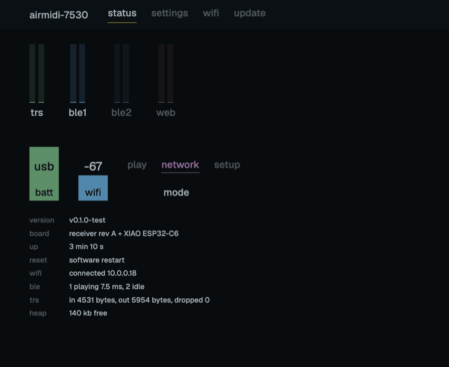
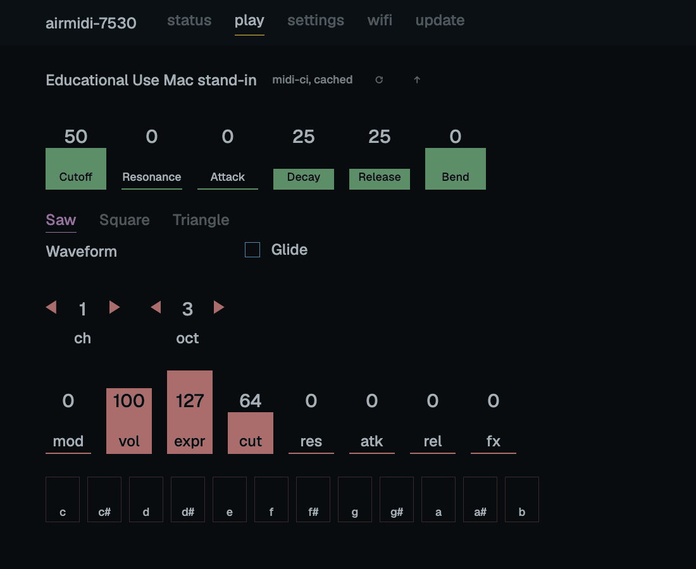

# airmidi

A battery-powered wireless MIDI interface: it gives any TRS/DIN MIDI device Bluetooth and Wi-Fi, is set up from a
browser, and updates itself over the air. Firmware for an ESP32-C6 / ESP32-S3 on a custom PCB in a 3D-printed box.

Status: all six phases of [the plan](docs/plan.md) done and tested on the real boards: the TRS <-> BLE MIDI bridge,
Wi-Fi modes, the web UI, signed over-the-air updates with rollback, Network MIDI 2.0, MIDI-CI (the box asks the
synth on its jacks for its controls and the web UI draws them), and the extras: RTP-MIDI, a BLE central for BLE
keyboards, updates over BLE, USB MIDI on the S3, and an ESP-NOW cable between two boxes. The plan's decision
log has every measured result; [docs/measurements.md](docs/measurements.md) the numbers with their method.





## What it does so far

- **TRS <-> BLE MIDI**, up to two BLE centrals, merged per output (real-time first, SysEx never broken by another
  source). One way through the box: BLE -> TRS 8.4 ms median, TRS -> BLE 9.5 ms, 0 lost in the hardware tests.
- **Wi-Fi modes**: Play (Wi-Fi off), Network (joins stored networks, `<name>.local`), Setup (own access point).
  Long press switches, 8 s press opens Setup, double press sends all notes off.
- **Web UI** at `http://<name>.local`: live traffic per port, battery, signal, mode, settings, Wi-Fi networks,
  firmware update. Plain JS, no framework, a flat borderless style; 18 KB, built into the firmware.
- **Network MIDI 2.0** host (UDP, `_midi2._udp`): macOS connects to it natively. FEC, retransmit and in-order
  delivery over Wi-Fi: 0 of 600 lost at 5 ms spacing, 6.7 ms median Mac -> TRS, 4.2 ms back.
- **MIDI-CI over TRS**: Discovery and Property Exchange with the device on the jacks (a full read in under a
  second at 31250 baud, ~50 ms for a known device from the flash cache). The play page draws the device's own
  faders, pickers and toggles from its control list (M2-117) and sends MIDI 2.0 values the box scales for the
  jack; synths without MIDI-CI get the same from an uploaded JSON profile. A CI host behind the box reaches the
  device through it: macOS finds the synth on the jacks over Network MIDI 2.0 by itself.
- **RTP-MIDI** (AppleMIDI, `_apple-midi._udp`) for clients without Network MIDI 2.0: lost packets repaired from
  the recovery journal, sessions taken back after the box restarts. With macOS's driver: 0 of 600 lost each way at
  5 ms spacing, 7.3 / 5.5 ms median.
- **BLE central**: the box connects by itself to a BLE MIDI keyboard or controller (any, by name or by address),
  pairing if it asks. 13.0 ms median device -> TRS in Play mode.
- **USB MIDI** on the S3: a class-compliant USB MIDI device named after the box, with the console beside it.
- **ESP-NOW cable**: two boxes pass MIDI radio to radio, no router; they find each other's channel by themselves.
  TRS -> box -> ESP-NOW -> box -> USB in 3.8 ms median, 0 lost.
- **Updates**: upload in the browser, fetch the latest GitHub release, or send it over BLE when the box is not on
  Wi-Fi; images must be signed, a new image proves itself with a self-test or the box rolls back; a crash leaves a
  downloadable core dump.
- **Battery**: gauge on A0, low warning, notes off and deep sleep when empty.

## How it is tested

- `lib/`: 17 suites of host unit tests under AddressSanitizer + UndefinedBehaviorSanitizer, including randomized
  round trips and property tests (the RTP-MIDI journal through 30-50% packet loss). The CI workflow runs them, the
  format check and the firmware builds (C6, XIAO S3, S3 dev kit) on every push; `tools/check.sh` runs the same
  steps locally.
- On the hardware, with an Arturia AudioFuse cabled to the box so both ends of every test sit on the Mac's clock:
  `tools/hil/bridge_test.py` (15 checks), `ota_test.py` (13: refused, accepted, rolled back), `release_test.py`
  (8), `web_test.py` (14), `ws_test.py`, `ci_test.py` (21, against `devices/mac_standin`, a MIDI-CI device on the
  Mac built from the same library), `mac_ci_test.py` (12), `resume_test.py` (14), `rtp_test.py` (against macOS's RTP-MIDI driver), `central_test.py`
  (14, against a BLE MIDI stand-in on the Mac), `ble_ota_test.py` (9), `usb_test.py` and `espnow_test.py` (9, a
  second box: an ESP32-S3 dev kit), `sleep_test.py`, `latency.py`. Their first runs found real bugs; each is in
  [docs/design](docs/design).

## Layout

```
lib/        portable C11 core, no ESP-IDF headers         docs/design/  one note per module
test/       host unit tests for lib/ (Unity)              tools/hil/    hardware-in-the-loop tools for the Mac
firmware/   ESP-IDF project (C6 and S3)                   spikes/       throwaway experiments, results in the plan
web/        the web UI (HTML/CSS/JS, gzipped into the firmware)
devices/    MIDI-CI device side: the Mac stand-in (CoreMIDI)
```

## Build

```sh
tools/check.sh                    # what CI runs: host tests, clang-format check, firmware for every board
firmware/build.sh c6 flash        # build and flash the C6 board (s3 for the XIAO S3, s3kit for an S3 dev kit)
```

ESP-IDF v5.5.5 or later in the v5.5 series (`IDF_PATH`, default `~/Developer/esp-idf`), CMake, and `uv` (for the pinned clang-format and the
Python test tools).

## License

MIT, see [LICENSE](LICENSE). Two bundled third-party parts keep their own licenses: the Unity test framework in
`test/unity/` (MIT, [test/unity/LICENSE.txt](test/unity/LICENSE.txt)) and the Geist font in `web/` (SIL Open Font
License 1.1, [web/OFL-Geist.txt](web/OFL-Geist.txt)).
