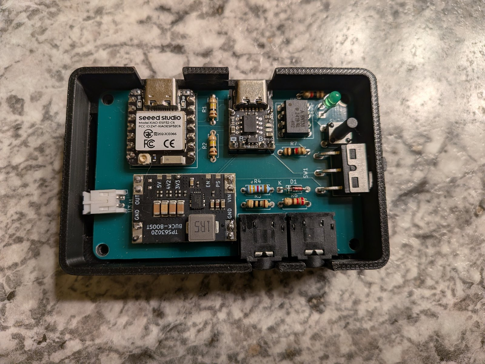
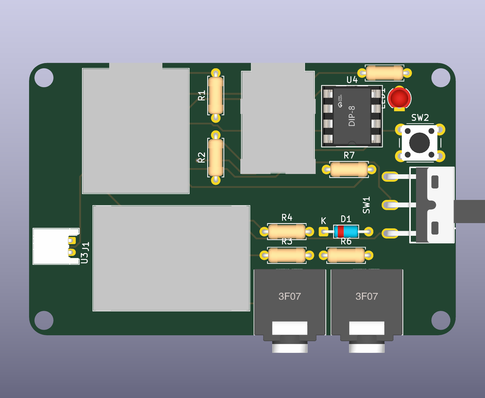

# Hardware: the AirMidi receiver, rev B



A 72 x 46 mm two-layer board for a Seeed XIAO ESP32-C6 or ESP32-S3, in an 80 x 52 x 27 mm 3D-printed box. The
photo shows rev A, the board the firmware was developed and tested on; this folder is rev B, which fixes rev A's
mistakes (see [Revisions](#revisions)).

The schematic, board and enclosure are generated from code (a Python circuit description, a layout file and a
build123d enclosure script) in a separate design workspace. The files here are that workspace's outputs, copied in by
an export script: they are replaced on every export, so edit the design there, not here.

## What's here

| Path | Contents |
|---|---|
| [pcb/schematic.pdf](pcb/schematic.pdf) | the schematic |
| [pcb/board.pdf](pcb/board.pdf), [pcb/board_3d.png](pcb/board_3d.png), [pcb/board_3d_bottom.png](pcb/board_3d_bottom.png) | the board: copper, silkscreen, 3D renders |
| [pcb/erc.txt](pcb/erc.txt), [pcb/drc.txt](pcb/drc.txt) | electrical and design rule checks: 0 errors, 0 unconnected, schematic and board in step |
| [pcb/kicad/](pcb/kicad) | the KiCad 10 project, with the symbols, footprints and 3D models it needs beyond KiCad's own library in `kicad/lib/` |
| [fab/midi_receiver_gerbers.zip](fab/midi_receiver_gerbers.zip) | Gerbers and Excellon drill file, as uploaded to JLCPCB (any 2-layer fab takes them) |
| [fab/bom.csv](fab/bom.csv) | every part, including the ones without a footprint (cell, screws) |
| [fab/bom_jlcpcb.csv](fab/bom_jlcpcb.csv), [fab/cpl_jlcpcb.csv](fab/cpl_jlcpcb.csv) | JLCPCB's BOM and placement formats |
| [enclosure/base.stl](enclosure/base.stl), [enclosure/lid.stl](enclosure/lid.stl) | the box, ready to slice (GitHub shows them in 3D); STEP files beside them |
| [enclosure/assembly_views.png](enclosure/assembly_views.png) | the board and every part inside the closed box |

The 3D models of the LCSC parts (TRS jacks, optocoupler, slide switch) are not included, as their license terms are
unclear; KiCad's 3D viewer shows those parts as bare footprints. The renders above were made with them.



## Circuit

```
phone / DAW  <~~ BLE MIDI, Wi-Fi ~~>  XIAO ESP32-C6 / S3  --UART TX--> 10R / 33R current loop --> J2 TRS out --> synth
                                            ^
keyboard --> J3 TRS in --> 220R + 1N4148 --> 6N138 optocoupler, 1k pull-up --UART RX

USB-C --> TP4057 charger module --> Li-ion cell 1050 mAh (J1) --> SW1 --> TPS63020 buck-boost --> 3.3 V --> XIAO 3V3
                                                                       '--> 100k / 100k divider --> A0 (battery gauge)
```

- **MIDI out**: a 3.3 V current loop (10 ohm on the source side, 33 ohm on the data side) to a TRS Type A jack:
  tip = DIN pin 5, ring = DIN pin 4.
- **MIDI in**: the MIDI spec's opto-isolated input with a 6N138: 220 ohm and a reverse 1N4148 on its LED, 1k pull-up
  to 3.3 V on its output.
- **Power**: the cell feeds a TP4057 charger module (USB-C, 500 mA) and, through the power switch, a TPS63020
  buck-boost that makes 3.3 V over the cell's whole range. Both are modules on header pins. The XIAO runs from its
  3V3 pin, so the switch must be off before the XIAO's own USB is plugged in.
- **User interface**: a status LED and a 13 mm tactile button that reach through the lid.

| Signal | XIAO pin | C6 GPIO | S3 GPIO |
|---|---|---|---|
| MIDI TX -> J2 | D6 | 16 | 43 |
| MIDI RX <- J3 | D7 | 17 | 44 |
| Battery sense | A0 | 0 | 1 |
| Status LED | D1 | 1 | 2 |
| Button (to GND) | D2 | 2 | 3 |

## Enclosure

Two parts that print without supports: the base, with a pocket for the cell under the board, and a flat lid. Four
M3 x 20 screws go through the lid and the board into the base. The jacks sit flush in the front wall, the power
switch's handle comes through a slot in the right wall, and both USB-C ports (charging, and the XIAO for flashing)
face the back.

## Measured on rev A

| What | Result |
|---|---|
| MIDI loopback J2 -> J3 at 31250 baud | 30208 of 30208 bytes correct; still clean at 62500 baud (2x headroom) |
| XIAO current, BLE connected | 40-50 mA |
| Battery gauge vs a multimeter | 3.726 V vs 3.74 V |
| Radio, ceramic antenna, box closed | BLE advertisement at the Mac -42 dBm, connection -50 dBm |
| Latency and loss through the box | in the firmware's [measurements](../docs/measurements.md) |

## Revisions

**Rev A** (ordered 2026-09-22, built 2026-10-03; the board in the photo):

- **Battery connector reversed.** JST-PH battery plugs have no standard polarity: the footprint put + on pin 1, but
  the cell's plug has its red lead on pin 2. Plugged in for the first time, the reversed cell destroyed the TP4057
  charger module. Lesson: check every cell's lead colours against the footprint's pad numbers before ordering.
- **Garbage on MIDI OUT at reset.** D6/D7 are the module's UART0 pins, and the chip's ROM bootloader prints its boot
  banner on UART0 TX before any firmware runs, which a synth reads as random MIDI messages. Fixed without a new
  board: one eFuse (`UART_PRINT_CONTROL`) silences the ROM output, and the firmware drives MIDI from UART1 routed to
  those pins ([board-and-settings.md](../docs/design/board-and-settings.md)).
- **An ESP32-C6 instead of the planned S3** (the S3s were back-ordered). The XIAO modules share a pinout, so the
  board did not change; the firmware's board layer maps the GPIOs. (The footprint keeps its `XIAO_ESP32S3` name.)
- **Enclosure too low** for the leads the hand-soldered parts leave under the board.

**Rev B** (this folder; not built yet): the cell connector's pins swapped to match the cell; the enclosure with 6 mm
under the board for those leads (27 mm tall overall), the cell pocket moved against the jack wall, and a gap in a
rib for the cell's lead.

## License

[CERN-OHL-P-2.0](LICENSE) (CERN Open Hardware Licence, permissive), for everything in this folder. The firmware and
the rest of the repository are MIT.
